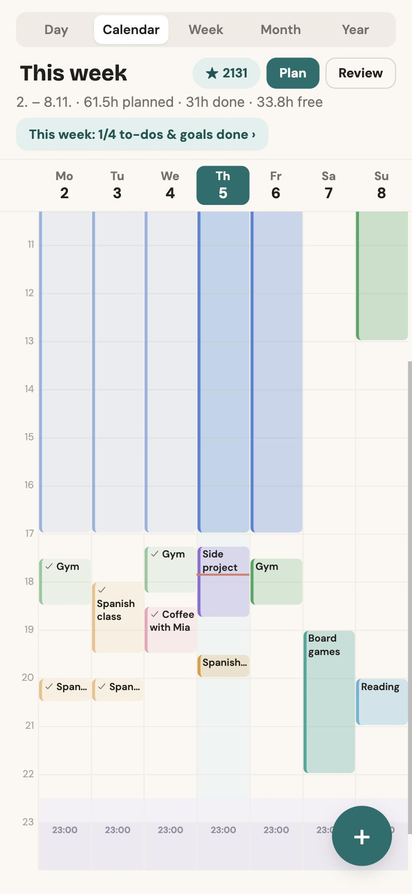
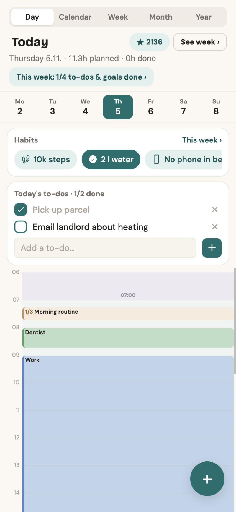
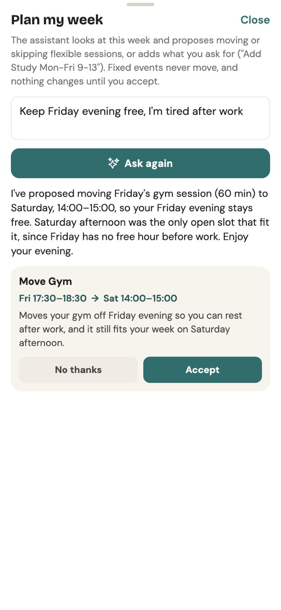
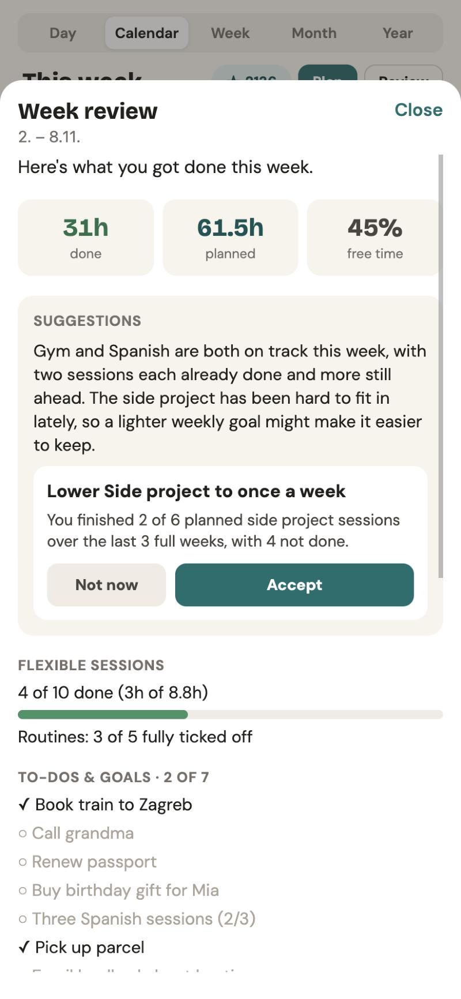
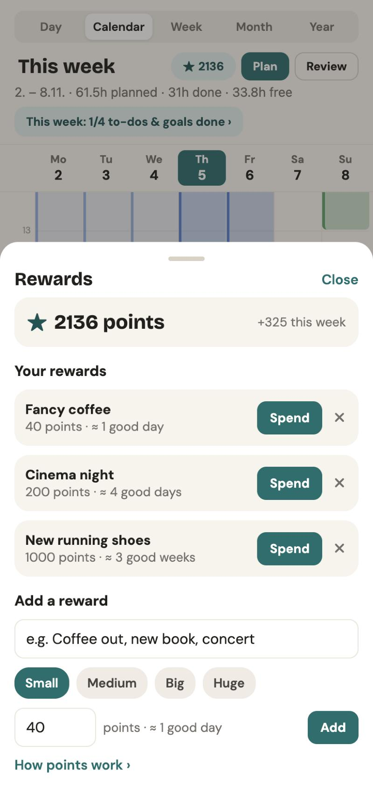

# Smart Calendar

A weekly planner for Android and web. Fixed things stay fixed, flexible goals
("Gym 60 min, 3x a week") are placed into the free gaps automatically, and the
app won't quietly overbook a week.

<p>
  
  
  
  
  
</p>

## AI features

- **Plan my week**: an agent reads the week and an optional wish ("study Mon–Fri
  9–13") and proposes moves, skips and new events. You accept or reject each one.
- **Weekly review and monthly summary**: small suggestions and a recap, based on
  what actually got done.
- **Journeys**: a goal becomes small weekly steps. A missed week repeats the step.
- **Coach check-in**: suggests the next step from when sessions were done or skipped.
- **Brain dump**: a list of wishes becomes habits, sorted into now, next and later.

The AI only proposes. The app's own scheduler checks every change before it is
saved, so the model can't double-book or overfill the week.

An MCP server also lets Claude Desktop / Claude Code read the calendar and find
free time.

## Points and rewards

Done sessions and events earn points, more for longer ones. Each group can count
double (work, learning) or give a flat 5 (rest, social), so a lazy afternoon
doesn't outscore an hour of hard work. You spend points on rewards you set
yourself. Past weeks are frozen; changing a group only re-counts the current week.

## Evaluation

The agent is tested on 10 sample weeks, each with a request such as "keep Friday
evening free". A test passes when the proposed changes are valid (no clashes,
nothing in the past, nothing locked moved) and do what was asked. Each test runs
3 times, because the model doesn't answer the same way every time.

The first version passed 7 of 10. The tests found a bug (sessions already in the
past could be moved); after fixing it, the agent passes 30 of 30.
Results: [`ai-service/evals/results.md`](ai-service/evals/results.md).

## Stack

- App: React Native (Expo), TypeScript, SQLite. The scheduler in `src/engine/`
  is pure TypeScript with unit tests.
- AI service (`ai-service/`): Python, FastAPI, LangGraph, Claude Haiku 5.5,
  Langfuse tracing, hosted on Vercel.

## Run

```bash
npm install && npm start           # the app
npm test                           # app tests
cd ai-service && .venv/bin/pytest  # AI service tests (no API calls)
```
