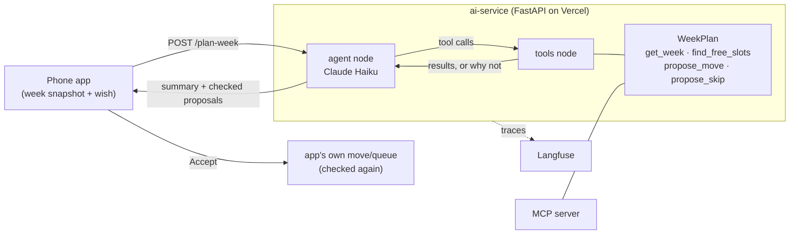

# Smart Calendar

A weekly planner for people with ADHD (Android + web, React Native / Expo). Fixed
things stay fixed, flexible goals ("Gym 60 min, 3x a week") are placed into the
gaps automatically, and the app refuses to silently overbook a week.

On top of a deterministic scheduling engine sit three AI features, served by a
small Python service on Vercel:

| Feature | What it does | How |
|---|---|---|
| **Plan my week** (agent) | Reads the week and an optional wish ("keep Friday evening free"), proposes moves and skips; the user accepts or rejects each | LangGraph tool loop, Claude Haiku 5.5, 4 calendar tools, Langfuse tracing |
| Weekly review | Looks at 4 weeks of what got done and suggests up to 3 small changes | Structured outputs (Pydantic), typed actions |
| Monthly summary | Wins, patterns, what slipped, one tip | Structured outputs, saved per month |

Plus an **MCP server** that lets Claude Desktop / Claude Code read the calendar
and find free time.

## Plan my week: the agent



Design choices:

- **The model can't break the calendar.** It has no write access. Every proposal
  goes through `WeekPlan`, which rejects clashes (with a 15-minute buffer), times
  outside the user's awake hours, the past, and locked or done sessions. A
  rejected proposal returns the reason, so the model can try another slot. The
  app re-checks each accepted proposal with its own engine before saving.
- **One set of tools, three users.** The agent, the MCP server and the evals all
  use the same `calendar_tools.py`, which has plain unit tests.
- **Small and cheap.** At most 5 changes per run, about 4 tool calls,
  ~6 seconds, ~$0.001 per run.

## Evaluation

`ai-service/evals/` has 10 test weeks with a wish each (or none). Every run gets
general checks (only movable sessions, no clashes after applying all proposals,
awake hours, ≤ 5 changes, a summary) plus the case's own checks: e.g. "Friday
evening has no flexible sessions left *and* none were dropped", "no day with two
gym sessions", "a wish about the past changes nothing".

| Version | Runs | Passed |
|---|---|---|
| First prompt and tools | 10 | 7 (70%) |
| Fixed a tool bug the evals found (sessions already in the past could be moved), `get_week` notes doubled sessions, clearer "spread out" rule | 30 (10 cases × 3) | **30 (100%)** |

Latest results: [`ai-service/evals/results.md`](ai-service/evals/results.md).
A run of the same version can pass 7/10 one time and 8.5/10 the next, so cases
are repeated (`--repeat 3`) before comparing versions.

CI (GitHub Actions) runs the unit tests and the eval harness with a fake model
on every push. The real evals run on demand and post the table to the run page.

## Layout

- `src/engine/`: the scheduler. Pure TypeScript (intervals, greedy planning, capacity), fully unit-tested.
- `src/db/`: SQLite (expo-sqlite), versioned migrations, tested against `node:sqlite`.
- `src/ui/`: React Native screens: day / week / month / year views, drag to move, habits, goals, reviews.
- `ai-service/`: FastAPI + LangGraph + Langfuse, the MCP server and evals. See its [README](ai-service/README.md).

## Run

```bash
npm install && npm start           # the app (Expo)
npm test                           # 230+ engine, DB and UI-logic tests
cd ai-service && .venv/bin/pytest  # AI service tests (no API calls)
```
